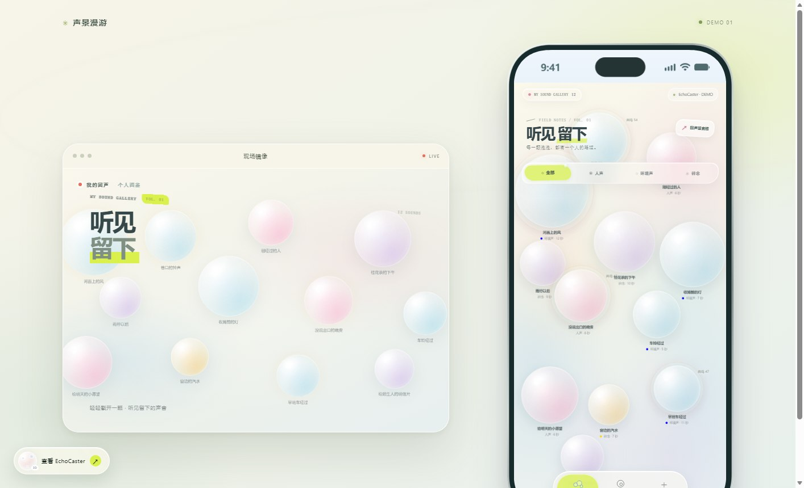
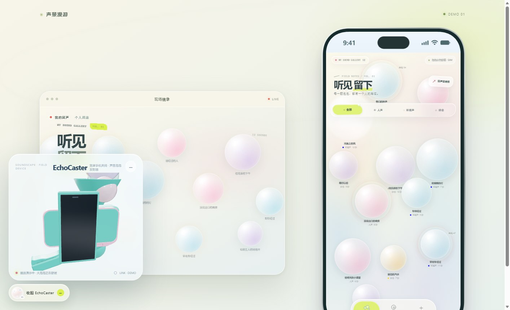
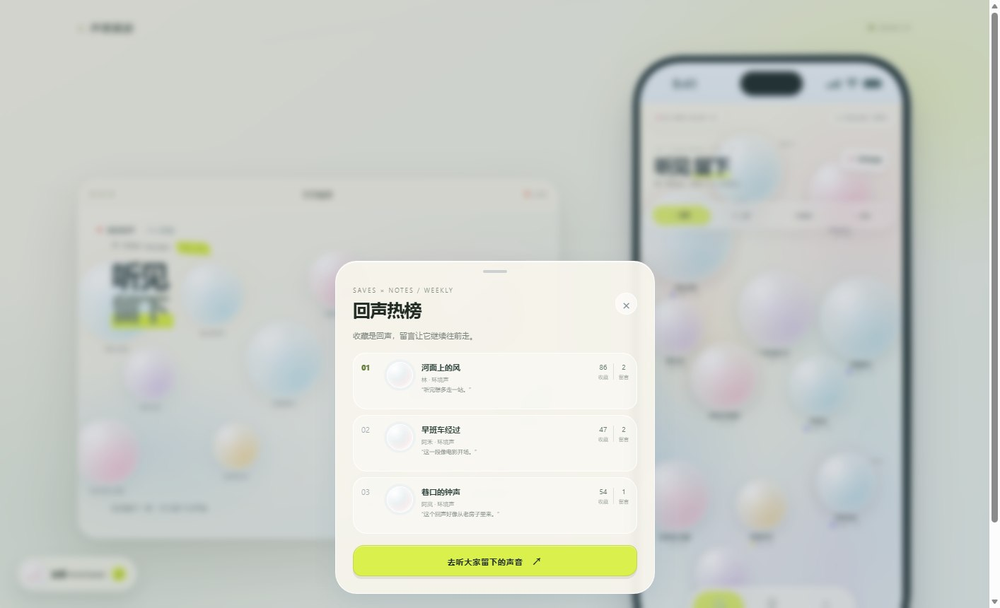
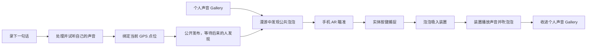

# 声景漫游 · Soundscape Roam

**走进街道，捕捉留在这里的声音。**

声景漫游把城市里的声音做成可以发现、戳开和接力的泡泡。概念体验中，用户用手机 AR 瞄准他人留下的声音，再通过实体装置完成捕捉；也可以录下一句话，留给后来经过的人。

> 当前仓库提供可交互的浏览器演示和 SwiftUI 视觉原型。GPS、ARKit、ESP32、真实录音与声纹处理、机械吹泡装置尚未接入；演示中的相关反馈是交互模拟。泡泡播放使用浏览器中文语音合成示例；漫游与共创页面使用项目提供的环境照片作为视觉底图。








## 交互细节

- 首页是个人声音 Gallery。心形、星形、花形、云朵形等泡泡以不规则布局铺满屏幕，缓慢漂浮、碰撞和回弹；焦点泡泡周围有一圈横向标签缓慢环转，也能手动拖动。点按会先挤压，再破裂成光圈与碎片，同时播放声音示例。
- 分类筛选会用流动虚线圈出匹配的声音，并让其他泡泡退暗；回声热榜综合收藏与留言互动，展示留言内容。
- 共创录音以模拟的声势驱动泡泡抖动、起伏和膨胀。完成发布后，Gallery 出现新泡泡，EchoCaster 模型同步打开并发射更大、间距更松的泡泡。
- 实体装置名为 **EchoCaster**，手机夹持结构以竖屏呈现。装置发泡、声音播放、AR、GPS 和录音都是 Demo 模拟状态；真实 ESP32 和机械吹泡尚未接入。

## 体验流程



**泡泡按录制时的 GPS 位置长期留存。**捕捉会把一份声音收进当前体验者的个人收藏，原泡泡仍留在原处，后来的人也能遇见。

## 界面结构

- **泡泡**：个人声音 Gallery 以满屏漂浮的泡泡呈现，不按地点组织。泡泡在屏幕中缓慢碰撞、反弹；点按会挤压破裂并播放示例声音。筛选时，匹配内容由流动虚线圈起，其他泡泡退到背景。回声榜把收藏数和留言放在一起，显示声音如何被接力。
- **漫游**：进入时依次展示空间扫描与画面缓冲，然后在真实街道照片上进行 AR 风格瞄准；插画泡泡以 2D 贴纸层叠在实景上，用户可缩放并选中不同距离或高度的声音目标，再按装置实体键触发捕捉。
- **共创**：选择“给下一位”或“留在此刻”，录音、试听、绑定位置并发布。
- **设备状态**：显示声景装置连接与播放状态。
- **设备模型**：桌面左下角入口打开 Three.js **EchoCaster**。模型将喇叭朝右、竖屏手机夹持仓正面朝向默认视角；拖动可查看其他角度。播放时，从喇叭口附近缓慢吐出少量较大的泡泡。材质根据 STL 几何推定，模型资源按需加载。
- **现场镜像**：桌面演示页同步展示手机当前界面，供 Demo Day 观众观看和参与共选。

## 本地运行

需要 Node.js 20.19 或更新版本。

```bash
npm install
npm run dev
```

Vite 会输出本地地址。可直接访问不同页面：

- `/?screen=home` 泡泡
- `/?screen=roam` 漫游
- `/?screen=create` 共创

浏览器演示支持个人 Gallery 异形泡泡场、焦点泡泡卫星轨道标签、按内容类型聚焦、点击破裂和中文语音合成试听、含收藏与评论的回声榜、扫描—缓冲—取景转场、街景上的 2D 插画泡泡与 AR 风格目标缩放/捕捉动画，以及录音、发布和 EchoCaster 发泡联动演示。录音能量、空间扫描、AR 目标位置和设备发泡均为程序模拟；演示不调用真实麦克风、不连接 ESP32，也不会启动 AR 相机或控制真实装置。泡泡枪展示的是提供的 STL 外形和推定 CMF。

```bash
npm run build
```

## 技术组成

- `src/`：Vite + React 的可交互演示；GSAP 页面动效、Three.js 装置模型和街景资源都在 `src/`。
- `src/assets/soundscape-device.stl.gz.part-1` 与 `part-2`：拆分存放的压缩 STL 数据。Three.js 打开装置面板时按需拼合、解压并载入，再根据模型的独立零件壳体应用演示 CMF。
- `native/SoundscapeDemoView.swift`：使用 SwiftUI Liquid Glass 的原生界面视图，要求 iOS 26+。当前仓库未包含 Xcode 工程，且该文件尚未在 Xcode 中编译验证。
- `docs/product-context.md`：产品目标、交互规则、游戏循环和软硬件分工。
- `docs/app-information-architecture.md`：可讨论的 App Mind Map、导航规则、Demo 分层和关键决策。
- `docs/demo-scope.md`：当前可演示能力与真实设备能力的边界。
- `docs/visual-direction.md`：泡泡材质、青春胶片拼贴、Liquid Glass 与页面色彩方向。
- `docs/newjeans-inspired-ui-asset-pack.md`：青春胶片、Y2K 拼贴、手绘贴纸、泡泡与标题字形的文生图提示词包。
- `docs/open-source-references.md`：泡泡物理、材质和点击破裂的开源参考与取舍。
- `docs/asset-use-map.md`：照片、贴纸、透明泡泡素材及本轮 moodboard 形状语言在页面中的使用位置。
- `docs/moodboard-ui-iteration.md`：本轮异形泡泡、轨道标签、AR 插画与进入取景转场的实现规格。
- `docs/ui-generation-prompts.md`：用于延展 App 组图的统一母提示词与逐屏提示词。
- `AGENTS.md`：供 coding agent 使用的项目约束和协作说明。

## 一起完善

欢迎同学通过 GitHub Issues 提出体验问题或功能建议，再通过 Fork + Pull Request 提交修改。请一次聚焦一个改动，说明用户体验变化，并附上界面截图或录屏。维护者会 review 后合并到 `main`；需要直接 push 的成员由仓库所有者在 GitHub 仓库设置中添加为 collaborator。详细步骤见 [`CONTRIBUTING.md`](./CONTRIBUTING.md)。

提交前运行 `npm run build`。请不要提交 `node_modules/`、`dist/`、本机密钥、真实用户录音或未经许可的声音素材。

## 给 AI coding agent 的入口

开始修改前先读 [`AGENTS.md`](./AGENTS.md)、[`docs/product-context.md`](./docs/product-context.md) 和 [`docs/demo-scope.md`](./docs/demo-scope.md)。实现中请明确区分“原型模拟”和“真实硬件/定位/音频集成”，不要把尚未接入的能力描述为已完成。
