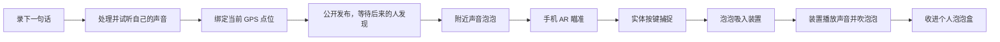

Warning: fs was declared with const; use let for reassignable variables.
# 声景漫游 · Soundscape Roam

**走进街道，捕捉留在这里的声音。**

声景漫游是一款结合手机 AR 与实体声音装置的城市探索体验。用户在街道中发现由其他人留下的声音泡泡，用手机瞄准，再按下装置上的实体按键完成捕捉；装置随即播放声音并吹出真实泡泡。用户也可以录下一句话，绑定当前位置，留给后来经过的人。

> 当前仓库提供可交互的浏览器演示和 SwiftUI 视觉原型。GPS、ARKit、ESP32、真实录音与声纹处理、机械吹泡装置尚未接入；演示中的相关反馈是交互模拟。

## 体验流程



**泡泡按录制时的 GPS 位置长期留存。**捕捉会把一份声音收进当前体验者的个人收藏，原泡泡仍留在原处，后来的人也能遇见。

## 界面结构

- **泡泡**：查看附近声音与个人收藏，点击泡泡试听。
- **漫游**：以手机 AR 作为瞄准镜，选中不同距离或高度的泡泡；按装置实体键触发捕捉。
- **共创**：选择“给下一位”或“留在此刻”，录音、试听、绑定位置并发布。
- **设备状态**：显示声景装置连接与播放状态。
- **现场镜像**：桌面演示页同步展示手机当前界面，供 Demo Day 观众观看和参与共选。

## 本地运行

需要 Node.js 20.19 或更新版本。

```bash
npm install
npm run dev
```

Vite 会输出本地地址。可直接访问不同页面：

- `/?screen=home` 泡泡
- `/?screen=roam` 漫游
- `/?screen=create` 共创

浏览器演示支持切换页面、泡泡试听状态、AR 目标缩放与捕捉动画、录音预览和发布状态。它不调用真实麦克风、不连接 ESP32，也不会启动 AR 相机。

```bash
npm run build
```

## 技术组成

- `src/`：Vite + React 的可交互演示；页面状态和交互入口在 `src/main.jsx`。
- `native/SoundscapeDemoView.swift`：使用 SwiftUI Liquid Glass 的原生界面视图，要求 iOS 26+。当前仓库未包含 Xcode 工程，且该文件尚未在 Xcode 中编译验证。
- `docs/product-context.md`：产品目标、交互规则、游戏循环和软硬件分工。
- `docs/demo-scope.md`：当前可演示能力与真实设备能力的边界。
- `AGENTS.md`：供 coding agent 使用的项目约束和协作说明。

## 一起完善

欢迎同学通过 GitHub Issues 提出体验问题或功能建议，再通过 Fork + Pull Request 提交修改。请一次聚焦一个改动，说明用户体验变化，并附上界面截图或录屏。维护者会 review 后合并到 `main`；需要直接 push 的成员由仓库所有者在 GitHub 仓库设置中添加为 collaborator。详细步骤见 [`CONTRIBUTING.md`](./CONTRIBUTING.md)。

提交前运行 `npm run build`。请不要提交 `node_modules/`、`dist/`、本机密钥、真实用户录音或未经许可的声音素材。

## 给 AI coding agent 的入口

开始修改前先读 [`AGENTS.md`](./AGENTS.md)、[`docs/product-context.md`](./docs/product-context.md) 和 [`docs/demo-scope.md`](./docs/demo-scope.md)。实现中请明确区分“原型模拟”和“真实硬件/定位/音频集成”，不要把尚未接入的能力描述为已完成。
