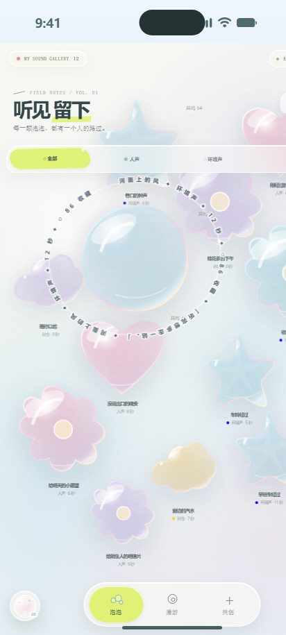
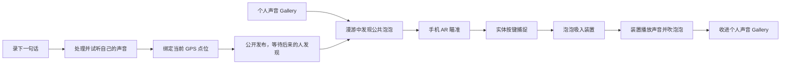

# Memo garden · 声景漫游

**走进街道，捕捉留在这里的声音。**

Memo garden 把城市里的声音变成可以发现、聆听和接力的泡泡。概念体验里，用户在附近取景中发现回声，也可以录下一句话留给后来经过的人。

> 当前仓库提供适配 Android 浏览器的 Vite + React 演示，以及独立的 SwiftUI 视觉原型；还没有 Android 工程或可安装 APK。漫游页可在 HTTPS 或 localhost 下申请后置摄像头；支持 hit-test 的 Android Chrome + ARCore 可启动 WebXR 空间 AR。其他 Android 浏览器也能用屏幕泡泡预览、点选和缩放，但这些泡泡不会伪装成真实空间锚点。GPS 目前只请求定位精度，示例泡泡没有真实坐标；Geospatial 锚点、ESP32、真实录音和机械吹泡尚未接入。





## 交互细节

- 首页是个人声音 Gallery。珍珠球、心形、星形、花形、云朵形等不同体积的泡泡以不规则布局铺满屏幕，缓慢漂浮、碰撞和回弹；环绕文字默认收起，悬停、键盘聚焦或选中泡泡时才显现，近侧文字清晰、远侧文字沉到泡泡之后。泡泡可拖动、相撞和戳破；破裂与液膜接触是 Canvas/CSS 视觉模拟，不是流体仿真。手机上首页以 30fps 更新漂浮碰撞，桌面现场镜像只在宽屏挂载，隐藏页面的动画会暂停。
- 分类筛选会用流动虚线圈出匹配的声音，并让其他泡泡退暗；回声热榜综合收藏与留言互动，展示留言内容。
- 漫游会请求摄像头权限。兼容的 Android Chrome + ARCore 可扫描真实平面并放置朝向观众的异形泡泡；点选后，独立卡片提供试听、查看留言和捕捉，缩放可用屏幕按钮或双指手势。其他浏览器显示明确标记的屏幕预览泡泡：它们可选、可缩放，但不是世界锚点。捕捉后有渐变水流把泡泡带至中央，轻点中央泡泡可试听语音合成示例。
- 共创录音以模拟声势驱动所选泡泡的挤压、呼吸、旋转和色彩变化；点按可切换露珠、心形、星形或花形。完成发布后，Gallery 出现新泡泡，EchoCaster 模型同步打开并发射更大、间距更松的泡泡。流程仍标有 SIM，不接真实麦克风。
- 实体装置名为 **EchoCaster**。默认视角正对观众，STL 本体的竖屏手机仓与握柄朝前展示；移除悬空的独立手机模型，并将程序化虚拟手贴合到柄位，呈现手掌包握、手指回扣的姿势。悬停或轻触三个设计标记可查看手机仓、出泡口与握柄的设计说明。实体发泡、设备联动、GPS 地理锚点和录音仍是 Demo 模拟状态；Android WebXR 平面 AR 已做设备能力受限的原型，虚拟手只用于握持姿势展示，真实 ESP32 和机械吹泡尚未接入。

## 体验流程



**泡泡按录制时的 GPS 位置长期留存。**捕捉会把一份声音收进当前体验者的个人收藏，原泡泡仍留在原处，后来的人也能遇见。

## 界面结构

- **泡泡**：个人声音 Gallery 以满屏漂浮的泡泡呈现，不按地点组织。泡泡在屏幕中缓慢碰撞、反弹，也可以拖动；两个泡泡相遇时会出现朝接触方向挤压的形变和短暂液膜。近景焦点球周围有交叉的倾斜文字轨道。点按会收缩并产生液膜翻卷、水滴下坠的视觉模拟，同时播放示例声音。筛选时，匹配内容由流动虚线圈起，其他泡泡退到背景。回声榜把收藏数和留言放在一起，显示声音如何被接力。
- **漫游**：先扫描和缓冲，再开启后置摄像头；兼容 WebXR 的设备在真实平面上放置泡泡，不兼容设备使用清楚标注的屏幕预览。选中后可试听、看留言、调大小并捕捉。
- **共创**：选择“给下一位”或“留在此刻”，录音、试听、绑定位置并发布。
- **设备状态**：显示声景装置连接与播放状态。
- **设备模型**：桌面左下角入口打开 Three.js **EchoCaster**。默认以观众正面展示 STL 本体，不再叠加悬空手机；程序化虚拟手包住实体柄位。悬停或轻触模型上的结构标记，可读到手机仓、上端出泡口与握持姿势的设计说明。拖动可查看其他角度，播放时装置缓慢吐出少量较大的泡泡。材质根据 STL 几何推定，模型资源按需加载。
- **现场镜像**：桌面演示页同步展示手机当前界面，供 Demo Day 观众观看和参与共选。

## 本地运行

需要 Node.js 20.19 或更新版本。

```bash
npm install
npm run dev
```

Vite 会输出本地地址。可直接访问不同页面：

- `/?screen=home` 泡泡
- `/?screen=roam` 漫游
- `/?screen=create` 共创

浏览器演示支持首页异形泡泡场、按需显示的文字轨道、碰撞拖动与破裂视觉、回声榜评论、扫描转场、相机取景和手绘 SVG 插画。兼容的 Android Chrome + ARCore 可用 WebXR hit-test 放置空间泡泡，选中后显式操作试听、留言和捕捉；此能力不是 GPS 地理锚点，也不使用固定图像标记。其他浏览器的屏幕泡泡仅用于可玩预览，不冒充空间锚点。捕捉光流、贴纸材质、录音能量、扫描 loading 和实体发泡都是程序模拟；演示不调用真实麦克风、不连接 ESP32、不控制真实装置。实时相机需 HTTPS/localhost 与浏览器授权。当前代码库尚未包含 Android 原生工程或 APK 签名配置。

```bash
npm run build
```

## 技术组成

- `src/`：Vite + React 的可交互演示；GSAP 页面动效、Three.js 空间 AR 泡泡与 EchoCaster 装置模型，以及街景资源都在 `src/`。
- `src/assets/soundscape-device.stl.gz.part-1` 与 `part-2`：拆分存放的压缩 STL 数据。Three.js 打开装置面板时按需拼合、解压并载入，再根据模型的独立零件壳体应用演示 CMF。
- `native/SoundscapeDemoView.swift`：使用 SwiftUI Liquid Glass 的原生界面视图，要求 iOS 26+。当前仓库未包含 Xcode 工程，且该文件尚未在 Xcode 中编译验证。
- `docs/product-context.md`：产品目标、交互规则、游戏循环和软硬件分工。
- `docs/app-information-architecture.md`：可讨论的 App Mind Map、导航规则、Demo 分层和关键决策。
- `docs/demo-scope.md`：当前可演示能力与真实设备能力的边界。
- `docs/visual-direction.md`：泡泡材质、青春胶片拼贴、Liquid Glass 与页面色彩方向。
- `docs/newjeans-inspired-ui-asset-pack.md`：青春胶片、Y2K 拼贴、手绘贴纸、泡泡与标题字形的文生图提示词包。
- `docs/open-source-references.md`：泡泡物理、材质和点击破裂的开源参考与取舍。
- `docs/asset-use-map.md`：照片、贴纸、透明泡泡素材及本轮 moodboard 形状语言在页面中的使用位置。
- `docs/moodboard-ui-iteration.md`：本轮异形泡泡、轨道标签、AR 插画与进入取景转场的实现规格。
- `docs/ui-generation-prompts.md`：用于延展 App 组图的统一母提示词与逐屏提示词。
- `AGENTS.md`：供 coding agent 使用的项目约束和协作说明。

## 一起完善

欢迎同学通过 GitHub Issues 提出体验问题或功能建议，再通过 Fork + Pull Request 提交修改。请一次聚焦一个改动，说明用户体验变化，并附上界面截图或录屏。维护者会 review 后合并到 `main`；需要直接 push 的成员由仓库所有者在 GitHub 仓库设置中添加为 collaborator。详细步骤见 [`CONTRIBUTING.md`](./CONTRIBUTING.md)。

提交前运行 `npm run build`。请不要提交 `node_modules/`、`dist/`、本机密钥、真实用户录音或未经许可的声音素材。

## 给 AI coding agent 的入口

开始修改前先读 [`AGENTS.md`](./AGENTS.md)、[`docs/product-context.md`](./docs/product-context.md) 和 [`docs/demo-scope.md`](./docs/demo-scope.md)。实现中请明确区分“原型模拟”和“真实硬件/定位/音频集成”，不要把尚未接入的能力描述为已完成。
