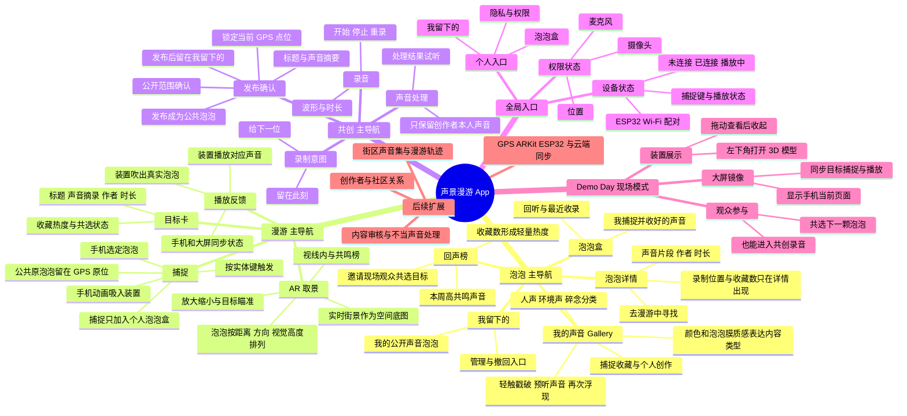

# 声景漫游 App Mind Map

> 讨论版信息架构。它描述的是产品目标和 Demo Day 闭环；文档会明确标出原型、演示和后续真实集成的边界。

## App Mind Map

## 导航规则

- 底部主导航固定为 **泡泡 / 漫游 / 共创**。
- 泡泡首页默认展示个人声音 Gallery，以人声、环境声、碎念分类；不按地点组织，也不显示距离。地点信息留在漫游页与单条声音详情。
- 泡泡盒与“我留下的”从泡泡页和个人入口进入，不新增第四个主导航项。
- 设备连接是全局状态；播放和捕捉在当前任务页面反馈。
- 大屏镜像属于 Demo Day 现场模式，不单独加入手机主导航。

## 两种“戳泡泡”动作

1. **泡泡页轻触**：戳破动画后播放声音预览；动画结束后泡泡重新出现，不改变公共原泡泡。
2. **漫游页捕捉**：手机瞄准目标后，按装置实体键触发捕捉；声音副本加入个人泡泡盒，公共原泡泡继续留在录制时的 GPS 点位。

这样区分后，首页更像可玩的声音发现界面，漫游才完成正式捕捉闭环。

## MVP / Demo Day / 后续

| 阶段 | 信息架构包含 | 目的 |
| --- | --- | --- |
| MVP Demo | 个人 Gallery、漫游、共创；内容类型筛选；回声榜；实体键捕捉状态 | 跑通回听、发现、捕捉、播放、共创 |
| Demo Day | 实景底图、手机画面上大屏、观众共选、3D 装置展示 | 让体验者和旁观者都能参与并看见软硬件协同 |
| 后续真实集成 | 实时 AR/GPS、ESP32 通信、真实录音与人声处理、持久化和跨端同步 | 把原型能力接到真实设备和服务 |

## 供讨论的关键决策

1. Gallery 是否把“我捕捉的”和“我创作的”混排，还是提供两个轻量筛选？
2. 榜单按收藏数、播放数还是两者组合排序？Demo Day 采用本周还是现场实时统计？
3. “戳破预听”是否始终只试听；只有实体按键才算捕捉？
4. 发布前是否必须确认声音公开范围，并允许作者撤回原泡泡？
5. 大屏观众共选用现场投票，还是由持机体验者确认最终目标？
6. GPS 漂移或室内定位不稳定时，Demo 用什么校准方式保证泡泡位置可信？

## 当前原型边界

当前网页已演示个人声音 Gallery 与类型筛选、泡泡破裂回听、回声榜、街景底图瞄准、捕捉反馈和基于最新 STL 的可旋转 3D 装置。语音合成、AR 位置、GPS、ESP32、真实录音与人声处理均未接入；请将这张 Mind Map 视为讨论用的目标架构，而非全部已实现清单。

