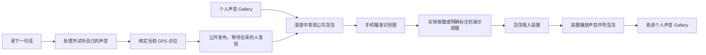

# Memo Garden · 声景漫游

**走进街道，捕捉留在这里的声音。**

Memo Garden 把城市里的声音变成可以发现、聆听和接力的泡泡。用户可以在取景中发现回声，也可以录下一句话留给后来经过的人。

> 当前仓库提供适配 Android 浏览器的 Vite + React 应用，以及独立的 SwiftUI 视觉原型；还没有 Android 工程或可安装 APK。漫游页使用 8 张可单独下载的图像识别图：首次扫描时在浏览器中编译目标并缓存，识别到目标后显示唯一映射的 3D 泡泡。相机需要 HTTPS/localhost 与用户授权；泡泡上下浮动可读取设备运动传感器。共创页使用浏览器麦克风录制并在本机试听，录音保留在当前会话中，不会上传或跨设备同步。实体按键可通过 WebSocket 桥接；实体装置、GPS 地理锚定、评论服务与机械吹泡尚未接入。


## 交互细节

- 首页是个人声音 Gallery。珍珠球、心形、星形、花形、云朵形等不同体积的泡泡以不规则布局铺满屏幕，缓慢漂浮、碰撞和回弹；环绕文字默认收起，悬停、键盘聚焦或选中泡泡时才显现，近侧文字清晰、远侧文字沉到泡泡之后。泡泡可拖动、相撞和戳破；破裂与液膜接触是 Canvas/CSS 视觉模拟，不是流体仿真。手机上首页以 30fps 更新漂浮碰撞，桌面现场镜像只在宽屏挂载，隐藏页面的动画会暂停。
- 分类筛选会用流动虚线圈出匹配的声音，并让其他泡泡退暗；回声热榜综合收藏与留言互动，展示留言内容。
- 漫游页先由用户主动开启扫描，再请求后置摄像头。MindAR 将 8 张独立高反差图编译为识别库，最多同时跟踪一个目标；识别图一一对应八段声音，泡泡以不同外形浮出纸面，并按设备倾斜上下轻浮。目标卡片可试听与查看/添加本机留言；新增留言仅保存在当前页面状态，后端尚未接入。配置 WebSocket 设备桥接后，收到实体按键消息即可捕捉。捕捉水流把泡泡送入详情，播放完后向屏幕右侧吸收。
- 共创页通过浏览器麦克风录制最长 30 秒的声音，并以实时音量驱动所选泡泡的挤压、呼吸、旋转和色彩变化；录音可在本机试听，发布后会在当前会话的 Gallery 显示。声音不会上传，也不会转成文字；录音泡泡仅存在于当前会话。点按可切换露珠、心形、星形或花形；Memo Catcher 模型会同步发射更大、间距更松的泡泡。
- 实体装置名为 **Memo Catcher**。默认视角正对观众，STL 本体的竖屏手机仓与握柄朝前展示；移除悬空的独立手机模型，并将虚拟手贴合到柄位。悬停或轻触设计标记可查看手机仓、出泡口与握柄说明。装置模型中的吐泡动画是界面反馈；GPS 地理锚点、真实 ESP32 联调与机械吹泡尚未接入。

## 体验流程



**泡泡按录制时的 GPS 位置长期留存。**捕捉会把一份声音收进当前体验者的个人收藏，原泡泡仍留在原处，后来的人也能遇见。

## 界面结构

- **泡泡**：个人声音 Gallery 以满屏漂浮的泡泡呈现，不按地点组织。泡泡在屏幕中缓慢碰撞、反弹，也可以拖动；两个泡泡相遇时会出现朝接触方向挤压的形变和短暂液膜。近景焦点球周围有交叉的倾斜文字轨道。点按会收缩并产生液膜翻卷、水滴下坠的视觉模拟，同时播放示例声音。筛选时，匹配内容由流动虚线圈起，其他泡泡退到背景。回声榜把收藏数和留言放在一起，显示声音如何被接力。
- **漫游**：用户主动开始扫描后，浏览器请求后置摄像头并载入 8 张图像识别目标。每张打印图唯一关联一颗泡泡；设备重力传感器控制泡泡的上下浮动，屏幕按钮可缩放。识别目标可试听、查看或添加本机留言；实体按键走可配置 WebSocket 桥接，未连接时通过模拟键演示。
- **共创**：选择“给下一位”或“留在此刻”，录音、试听、绑定位置并发布。
- **设备状态**：显示声景装置连接与播放状态。
- **设备模型**：桌面左下角入口打开 Three.js **Memo Catcher**。默认以观众正面展示 STL 本体，不再叠加悬空手机；虚拟手包住实体柄位。悬停或轻触模型上的结构标记，可查看手机仓、上端出泡口与握持姿势的说明。拖动可查看其他角度，播放时装置缓慢吐出少量较大的泡泡。模型资源按需加载。
- **现场镜像**：桌面演示页同步展示手机当前界面，供 Demo Day 观众观看和参与共选。

## 本地运行

需要 Node.js 20.19 或更新版本。

```bash
npm install
npm run dev
```

Vite 会输出本地地址。可直接访问不同页面：

- `/?screen=home` 泡泡
- `/?screen=roam` 漫游
- `/?screen=create` 共创

浏览器应用包含首页泡泡物理、回声榜留言，以及基于 MindAR 的图像识别 AR。共创页使用 `MediaRecorder` 录制最多 30 秒的本地音频，并支持试听；录音只在当前浏览器会话可用，不含语音转写或服务端保存。8 张识别图位于 `public/markers/`，可从漫游页单张下载；首次扫描在线载入识别引擎、编译并把目标库缓存到 IndexedDB。相机需 HTTPS/localhost 和浏览器授权，设备重力动画按浏览器传感器权限工作，否则使用轻柔浮动。设备信号通过 `?deviceWs=wss://…`、`VITE_MEMO_CATCHER_WS`（兼容旧名 `VITE_ECHOCASTER_WS`）配置 WebSocket 消息桥接；默认没有硬件连接。细节见 [图像识别 AR 与设备桥接说明](./docs/ar-image-target-setup.md)。本仓库尚无 Android 原生工程、APK 签名配置、真实 GPS 锚点、评论后端或 ESP32 固件。

```bash
npm run build
```

## 技术组成

- `src/`：Vite + React 应用；GSAP 页面动效、MindAR 图像追踪、Three.js 异形空间泡泡与 Memo Catcher 装置模型，以及街景资源都在 `src/`。
- `src/assets/soundscape-device.stl.gz.part-1` 与 `part-2`：拆分存放的压缩 STL 数据。Three.js 打开装置面板时按需拼合、解压并载入，再根据模型的独立零件壳体应用演示 CMF。
- `native/SoundscapeDemoView.swift`：使用 SwiftUI Liquid Glass 的原生界面视图，要求 iOS 26+。当前仓库未包含 Xcode 工程，且该文件尚未在 Xcode 中编译验证。
- `docs/product-context.md`：产品目标、交互规则、游戏循环和软硬件分工。
- `docs/app-information-architecture.md`：可讨论的 App Mind Map、导航规则、Demo 分层和关键决策。
- `docs/demo-scope.md`：当前可演示能力与真实设备能力的边界。
- `docs/ar-image-target-setup.md`：八张识别图、首次编译缓存、传感器漂浮和 WebSocket 设备桥接方式。
- `docs/visual-direction.md`：泡泡材质、青春胶片拼贴、Liquid Glass 与页面色彩方向。
- `docs/newjeans-inspired-ui-asset-pack.md`：青春胶片、Y2K 拼贴、手绘贴纸、泡泡与标题字形的文生图提示词包。
- `docs/open-source-references.md`：泡泡物理、材质和点击破裂的开源参考与取舍。
- `docs/asset-use-map.md`：照片、贴纸、透明泡泡素材及本轮 moodboard 形状语言在页面中的使用位置。
- `docs/moodboard-ui-iteration.md`：本轮异形泡泡、轨道标签、AR 插画与进入取景转场的实现规格。
- `docs/ui-generation-prompts.md`：用于延展 App 组图的统一母提示词与逐屏提示词。
- `AGENTS.md`：供 coding agent 使用的项目约束和协作说明。

## 一起完善

欢迎同学通过 GitHub Issues 提出体验问题或功能建议，再通过 Fork + Pull Request 提交修改。请一次聚焦一个改动，说明用户体验变化，并附上界面截图或录屏。维护者会 review 后合并到 `main`；需要直接 push 的成员由仓库所有者在 GitHub 仓库设置中添加为 collaborator。详细步骤见 [`CONTRIBUTING.md`](./CONTRIBUTING.md)。

提交前运行 `npm run build`。请不要提交 `node_modules/`、`dist/`、本机密钥、真实用户录音或未经许可的声音素材。

## 给同学与 AI coding agent 的入口

### 项目入口

- 仓库登记的演示地址：[https://ai-builer-context.vercel.app](https://ai-builer-context.vercel.app)。AR 相机需要 HTTPS 和用户授权。
- 产品名：**Memo Garden · 声景漫游**；实体装置模型名：**Memo Catcher**。
- 配色定义在 src/styles-editorial.css：纸白 #f7f4e9、亮纸白 #fcfbf4、墨绿 #202b24、森林绿 #203b2e、苔绿 #a8c98b、荧光草绿 #d9f04d、浅蓝 #c8e3f2、雾粉 #efc5d4；玻璃填色 rgba(250,249,239,.64)、玻璃描边 rgba(255,255,255,.88)、玻璃投影 0 18px 46px rgba(57,77,51,.12) inset 0 1px 0 rgba(255,255,255,.92)。插画、UI 截图、模型源文件和设计说明已整理到 [handoff/Memo-Garden-Asset-Pack/](./handoff/Memo-Garden-Asset-Pack/)，可下载 [独立素材包](./handoff/Memo-Garden-Asset-Pack.zip)；校验备份在 [handoff/backups/Memo-Garden-Asset-Pack-backup.zip](./handoff/backups/Memo-Garden-Asset-Pack-backup.zip)。
- 八张识别图的独立 SVG 在 public/markers/，漫游页也可逐张下载：memo-01-river-wind（河面上的风）、memo-02-alley-bell（巷口的钟声）、memo-03-passing-steps（刚经过的人）、memo-04-osmanthus-tea（桂花茶的下午）、memo-05-after-rain（雨停以后）、memo-06-market-light（收摊前的灯）、memo-07-goodnight（没说出口的晚安）、memo-08-bicycle-bell（车铃经过）。

### 人与 Agent 的协作说明

开始修改前按顺序阅读 [AGENTS.md](./AGENTS.md)、[docs/product-context.md](./docs/product-context.md)、[docs/demo-scope.md](./docs/demo-scope.md) 和 [docs/ar-image-target-setup.md](./docs/ar-image-target-setup.md)。项目使用 React + Vite；Three.js/MindAR 通过 index.html import map 在浏览器加载，ImageTargetARStage.jsx 必须继续通过运行时 import helper 导入，避免被 Vite 静态解析。

录音、演示泡泡和留言目前没有服务端持久化；WebSocket 仅为可配置桥接接口，默认是明确标注的 Demo 模式。网页不能扫描附近 Wi-Fi 或读取任意设备 RSSI；仓库没有 ESP32 固件，也没有硬件联调验证。不要把原型模拟描述成已完成的真实设备联动。native/SoundscapeDemoView.swift 属于独立视觉原型，本次 Web 修复不代表 SwiftUI 已同步。
